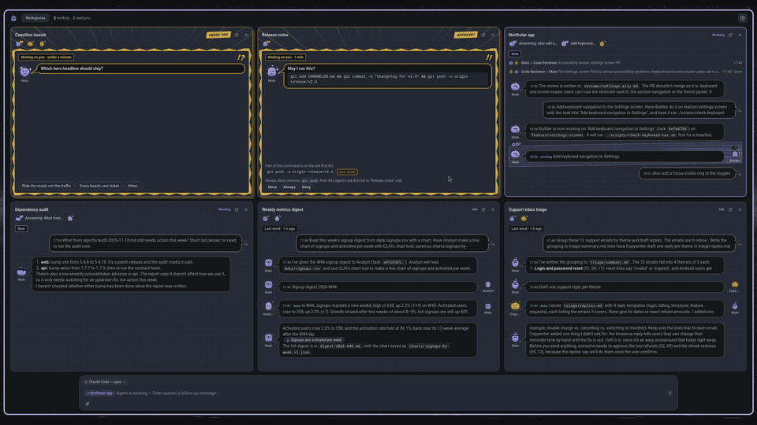

<p align="center">
  
</p>

<h1 align="center">CLAI</h1>

<p align="center">
  <a href="https://opensource.org/licenses/MIT"></a>
  <a href="https://github.com/clairun/clai/releases"></a>
  <a href="https://github.com/clairun/clai/actions/workflows/ci.yml"></a>
</p>

<p align="center">
  Control teams of AI agents. Local-first, open source, sandboxed.
</p>

<p align="center">
  <em>One team per workspace — every agent with its own provider, files, tools,
  and permissions, working in parallel, on your schedule, and reporting to you
  from one Fleet cockpit.</em>
</p>

<p align="center">
  <a href="https://clai.run/"></a>
  <br>
  <a href="https://clai.run/"><strong>Explore CLAI</strong></a>
</p>

## What it is

CLAI organizes work into **workspaces**. A workspace is an ongoing
conversation with a **main agent** — a configurable LLM that owns the
workspace's provider, tools, skills, and permissions. The main agent can:

- **Chat** with you in a surface that stays front and center
- **Use tools** through attached MCP servers and a local shell sandbox
- **Delegate** to helper agents in the same workspace, each with their own
  skills, tools, and execution policy
- **Persist context** — memories and artifacts it writes are inspectable from
  the workspace header
- **Run on a schedule** — periodic workspaces fire on their interval

The **Fleet** view supervises everything: scheduled workspaces float to the
top, anything needing attention (failed or blocked tasks, input prompts) is
flagged, and selecting a card slides in a live chat preview.

## Features

- **Workspace-local agent teams** — Add helpers (e.g. a Code Reviewer or SoW
  Tracker) with their own prompts, skills, MCP servers, providers, and
  execution policy. The main agent calls them as tools, and you can read their
  full transcripts.
- **Multiple providers** — API connections (OpenAI-compatible or
  Anthropic-compatible) and local CLI agents such as Claude Code, OpenAI
  Codex, and OpenCode. Each agent picks its own.
- **MCP-native tools** — Configure MCP servers once in Settings, then attach
  them per workspace or per agent. HTTP and stdio transports.
- **Local execution sandbox** — Per-agent filesystem grants and three shell
  modes: *Off* (no generic local file access), *Ask first* (every command
  runs, except that commands on the agent's ask-first list, such as
  `git push`, `rm` or `npm publish`, wait for your approval), and *Don't
  ask* (every command runs without asking). The ask-first list catches
  common accidents, not a determined agent: on Linux and macOS the OS
  sandbox and your path grants are the boundary. On an ask-first card,
  *Always allow* removes the rule from the agent's list: for a shared
  teammate in every workspace that uses it, for a workspace's main agent
  in that workspace only. Add a rule back in the agent's settings to be
  asked again.
- **Network modes** — Each agent has one of three, in its Local access settings:
  *Off* (no network for shell commands or the web tools), *Allowlist* (only
  the hosts matching the agent's allowed hosts, about 100 package registries
  and code hosts by default, never those matching its denied hosts; web search
  still reaches its search provider), and *Host network (unfiltered)*, which
  reaches any host, including services on your computer and your local
  network. Allowlist never connects to loopback or link-local addresses, so
  services that listen only on your computer's localhost stay out of reach,
  but a host you list that resolves to a local-network address is reachable
  from shell commands. In Allowlist an agent that needs another host asks
  for it, and you allow it for the run or always, allow its parent domain
  instead, or deny it.
- **A shared agent library** — Teammates are defined once in Settings →
  *Agents* and added to the workspaces that need them. Editing one reaches every
  workspace using it; each workspace still owns its own main agent, history and
  schedule.
- **Default skills** — CLAI registers the read-only `clairun/clai-skills`
  repository by default.
- **Inspectable tasks** — Delegated work streams a live transcript: the
  helper agent's full conversation, tool calls, and verdict.
- **Memory & artifacts** — Agents persist findings to the workspace directory;
  the drawer surfaces both, with read-only previews (rendered markdown, pretty
  JSON, multi-file HTML).
- **Run notices** — A run that hits a policy denial finishes in an amber
  "warnings" state and surfaces in the Fleet, instead of failing silently.

> **Local execution sandboxing is platform-specific.** On Linux, shell commands
> run through bubblewrap; in Allowlist each command gets its own network
> namespace whose only way out is CLAI's network proxy, through the small
> `clai-sandbox-helper` binary installed next to `clai`. Tools that ignore
> `HTTP(S)_PROXY`, and DNS lookups, fail there; choose Host network for
> them. On macOS, they run through Seatbelt via
> `sandbox-exec`, with Off or Host network only: Allowlist is not available on
> macOS yet. **On Windows there is no sandbox backend**: shell execution is
> labeled as a host shell, and while CLAI still validates the command's working
> directory against the filesystem grants, nothing stops the command itself from
> reaching outside them. Windows also ships no POSIX shell, so `bash_exec`
> looks for Git Bash, then MSYS2, then `bash` on `PATH`, and fails with an
> "install Git for Windows" notice when it finds none. The allow/block lists
> are enforced by CLAI before a command spawns, on every platform. On Windows
> the network setting applies to the web tools only: Off and Host network
> restrict or open web fetch and web search, and shell commands use the host
> network. Allowlist cannot be chosen there; a stored one (a hand edit or a
> config copied from Linux) stops shell commands until you choose Off or Host
> network.

## Install

Download the latest build for your platform from the
[Releases page](https://github.com/clairun/clai/releases):

| Platform    | Download |
|-------------|----------|
| Windows     | `.msi` / `.exe` |
| macOS       | `.dmg` |
| Linux       | `.deb`, `.rpm`, or `.flatpak` |
| Arch Linux  | AUR: [`clai-desktop-bin`](https://aur.archlinux.org/packages/clai-desktop-bin) |

On Debian/Ubuntu you can install from the CLAI apt repository instead —
updates then arrive through `apt upgrade` like any other package:

```bash
sudo curl -fsSLo /usr/share/keyrings/clai-archive-keyring.gpg \
  https://download.clai.run/apt/clai-archive-keyring.gpg
echo "deb [arch=amd64 signed-by=/usr/share/keyrings/clai-archive-keyring.gpg] https://download.clai.run/apt stable main" | \
  sudo tee /etc/apt/sources.list.d/clai.list
sudo apt update && sudo apt install clai
```

On Fedora/RHEL, the CLAI rpm repository does the same for `dnf upgrade`:

```bash
sudo curl -fsSLo /etc/yum.repos.d/clai.repo https://download.clai.run/rpm/clai.repo
sudo dnf install clai
```

openSUSE: `sudo zypper ar -f https://download.clai.run/rpm clai && sudo zypper install clai`

(Installing the `.deb`/`.rpm` from the Releases page enrolls the same
repository automatically; see `packaging/linux-repo/README.md`, including
the opt-outs.)

On macOS, the builds are not yet signed or notarized with an Apple
Developer ID, so after downloading macOS may say "clai is damaged and
can't be opened". The app is not damaged. Move `clai.app` to
Applications, run this once in Terminal to remove the download
quarantine flag, then open it normally:

```bash
xattr -cr /Applications/clai.app
```

## Getting started

1. **Add a provider** — In Settings, connect an API provider or point CLAI at
   a local CLI agent. Supported CLI agents are auto-detected and pre-wired into
   new workspaces.
2. **Add MCP servers (optional)** — Register local or remote MCP servers for
   external tools.
3. **Create a workspace** — From the Fleet view. Open its settings (gear icon
   in the header) to attach a provider, MCP servers, and skills.
4. **Chat** with the main agent.
5. **Add helper agents (optional)** — Define them once in Settings → *Agents*,
   then add them to a workspace's team from its settings; the main agent can
   then delegate to them.
6. **Make it periodic (optional)** — Toggle *Schedule* to run the main agent
   on an interval.

## Providers

- **API connections** — Add an **OpenAI-compatible** or **Anthropic-compatible**
  provider with an API key and optional custom base URL. Works with OpenAI,
  Anthropic, together.ai, Groq, and local endpoints (vLLM, llama.cpp, Ollama).
- **CLI agents** — Drive a locally installed coding CLI directly, such as
  **Claude Code**, **OpenAI Codex**, or **OpenCode**. CLAI exposes its tools to
  them over MCP and streams their output like any other run.

Each agent chooses its own provider, so you can mix — for example a Claude
Code main agent with an OpenAI-compatible reviewer.

## Development

```bash
git clone https://github.com/clairun/clai.git
cd clai
npm install
make dev            # run the desktop app in development
```

`make dev` builds the sandbox helper before it starts the app. `cargo run` and
`npm run tauri:dev` build only the app, and the Allowlist network mode also
needs the helper next to it: build it with
`cargo build --manifest-path src-tauri/Cargo.toml --bins`, or shell commands in
Allowlist fail with "network helper not found".

Before pushing:

```bash
npm run lint && npm run format:check && npm run build
cargo fmt --manifest-path src-tauri/Cargo.toml --check
cargo clippy --manifest-path src-tauri/Cargo.toml --all-targets -- -D warnings
cargo test --manifest-path src-tauri/Cargo.toml
```

## Architecture

- **Frontend** — React + Tauri; a chat-first workspace with a drawer for
  agents / tasks / memories / artifacts and slide-out transcript and file panels.
- **Runtime** — Each workspace owns its main agent, its assignments of shared
  agents, and a persistent session. Built-in tools (shell execution, inter-agent
  calls, task management) plus MCP tools, gated by each agent's policy. An agent
  is resolved fresh at the start of every turn, so a shared edit lands on the
  next turn and never mid-tool-sequence.
- **Scheduler** — Periodic workspaces run from the agent runner, emitting the
  same streaming events as interactive chat.
- **Skills** — Discovered from read-only local or git sources. The app-managed
  default source is `clairun/clai-skills`.

## License

MIT
